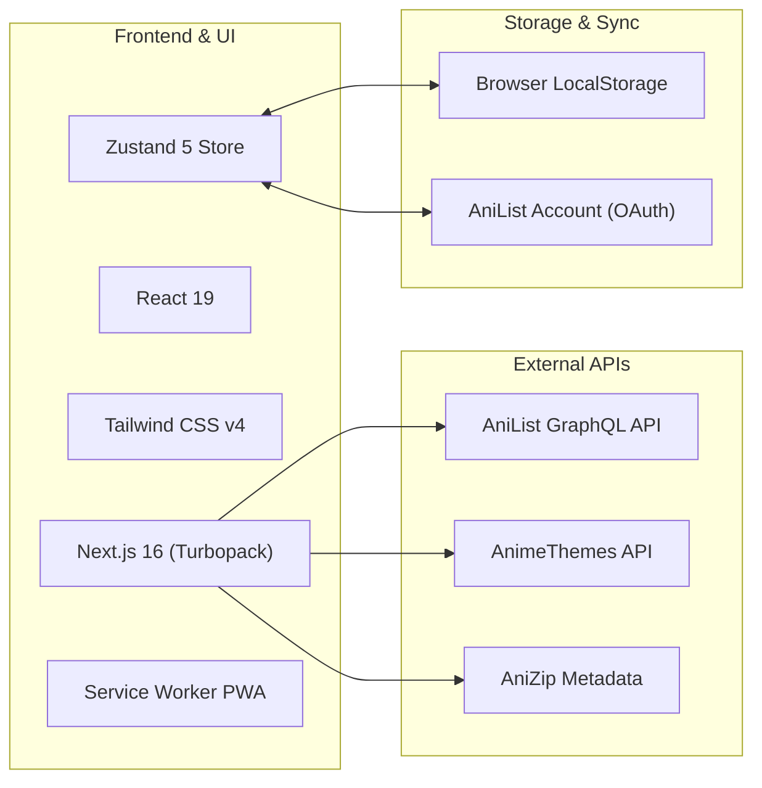

<div align="center">

<!-- Animated Header -->


<!-- Typing Animation -->
<a href="https://kuroiru-production.up.railway.app">
  
</a>

<br/>

<!-- Live Website & Status Badges -->
[](https://kuroiru-production.up.railway.app)
[](https://kuroiru-production.up.railway.app)
[](https://nextjs.org/)
[](https://react.dev/)
[](https://tailwindcss.com/)
[](https://www.typescriptlang.org/)

<br/>

<!-- Aesthetic Anime Showcase GIF -->


<br/>


</div>

## 🌐 Live Website

> **Experience the app live in your browser:**  
> 👉 **[https://kuroiru-production.up.railway.app](https://kuroiru-production.up.railway.app)**

*No sign-up or database required to start tracking! Your list and history are automatically preserved locally on your device.*

---

## ✨ Features at a Glance

<table>
  <tr>
    <td width="50%">
      <h3 align="center">⚡ Zero-Database Architecture</h3>
      <p align="center">
        
      </p>
      <ul>
        <li>Pure client + edge API routes — no SQL or NoSQL DB setup.</li>
        <li>Instant localStorage persistence with reactive Zustand state.</li>
        <li>Sub-second cold-starts and lightning-fast page transitions.</li>
      </ul>
    </td>
    <td width="50%">
      <h3 align="center">🔄 AniList Two-Way Sync</h3>
      <p align="center">
        
      </p>
      <ul>
        <li>One-click OAuth sign-in with your official AniList account.</li>
        <li>Bi-directional synchronization of statuses, progress, and scores.</li>
        <li>Track as <em>Watching</em>, <em>Completed</em>, <em>Planning</em>, <em>Paused</em>, or <em>Dropped</em>.</li>
      </ul>
    </td>
  </tr>
  <tr>
    <td width="50%">
      <h3 align="center">🎵 AnimeThemes Music Player</h3>
      <p align="center">
        
      </p>
      <ul>
        <li>Listen to and watch high-bitrate Opening (OP) and Ending (ED) videos.</li>
        <li>Song metadata, artist credits, episode spans, and alternate versions.</li>
        <li>Direct integration with the AnimeThemes public API.</li>
      </ul>
    </td>
    <td width="50%">
      <h3 align="center">📅 Airing Calendar & Countdown</h3>
      <p align="center">
        
      </p>
      <ul>
        <li>Day-by-day weekly schedule for ongoing seasonal anime.</li>
        <li>Live countdown timers to upcoming episode broadcasts.</li>
        <li>Episode titles and AniZip-powered runtimes and metadata.</li>
      </ul>
    </td>
  </tr>
</table>

---

## 🛠️ Tech Stack & Ecosystem



- **Framework:** [Next.js 16](https://nextjs.org/) (App Router, Server Components & Route Handlers)
- **UI Library:** [React 19](https://react.dev/)
- **Styling:** [Tailwind CSS 4](https://tailwindcss.com/) with custom dark neon/pastel palette
- **State Management:** [Zustand](https://github.com/pmndrs/zustand) with auto-hydration & localStorage sync
- **Icons:** [Lucide React](https://lucide.dev/)
- **Data APIs:**
  - [AniList GraphQL API](https://anilist.gitbook.io/anilist-apiv2-docs/) (Anime metadata, schedules, ratings, user lists)
  - [AnimeThemes API](https://api-docs.animethemes.moe/) (OP/ED video streaming & theme music)
  - [AniZip](https://github.com/anime-skip/ani-zip) (Episode mapping and anime title cross-referencing)
- **Deployment:** [Railway](https://railway.app/) / [Netlify](https://www.netlify.com/)

---

## 🚀 Getting Started

Follow these steps to run Kuroiru locally on your machine.

### Prerequisites

- **Node.js** 20.x or later (recommended Node 22+)
- **npm** 10.x or later

### 1. Clone the repository

```bash
git clone https://github.com/adityasingh3305/kuroiru.git
cd kuroiru
```

### 2. Install dependencies

```bash
npm install
```

### 3. Configure environment variables (Optional)

Create a `.env.local` file in the root directory:

```env
# Optional: Set your AniList Client ID to enable user OAuth authentication
NEXT_PUBLIC_ANILIST_CLIENT_ID=your_anilist_client_id_here
```

> [!NOTE]
> The app is fully functional without AniList credentials! All search, calendar, theme player, and local watchlists operate out-of-the-box. Adding a Client ID simply allows users to log into AniList and sync their personal lists.

### 4. Run the development server

```bash
npm run dev
```

Open [http://localhost:3000](http://localhost:3000) in your browser to view the application.

---

## 📜 Available Scripts

| Command | Description |
| :--- | :--- |
| `npm run dev` | Starts the Next.js development server with Turbopack |
| `npm run build` | Compiles and optimizes the app for production |
| `npm run start` | Starts the production server |
| `npm run lint` | Runs ESLint to check for code quality issues |
| `npm run typecheck` | Validates TypeScript types across the project |

---

## 📱 Progressive Web App (PWA)

Kuroiru includes built-in PWA capabilities:
- **Installable:** Add to Home Screen on iOS, Android, and Desktop Chrome/Edge.
- **Offline Access:** Service Worker caches assets and recent watchlist entries.
- **Dark Aesthetic:** Designed with an OLED-friendly dark theme (`#151515`).

---

## 🤝 Contributing

Contributions, bug reports, and feature requests are welcome!  
Feel free to open an issue or submit a pull request on [GitHub](https://github.com/adityasingh3305/kuroiru).

---

<div align="center">


**[Kuroiru](https://kuroiru-production.up.railway.app)** is built for anime enthusiasts.  
Anime data provided by [AniList](https://anilist.co/) & theme music provided by [AnimeThemes](https://animethemes.moe/).

</div>
